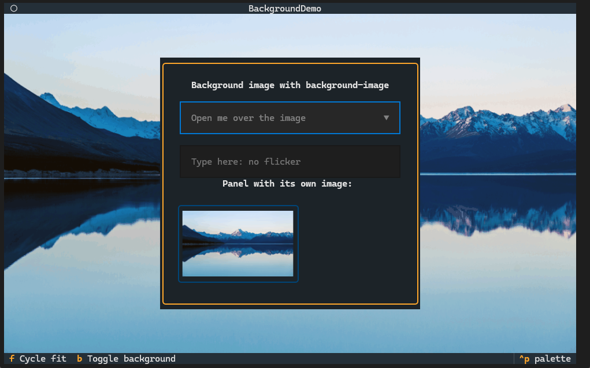
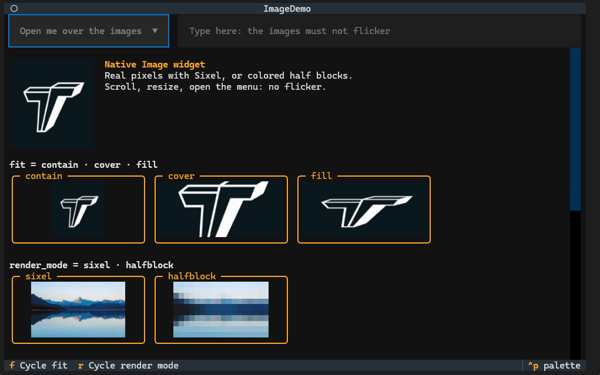
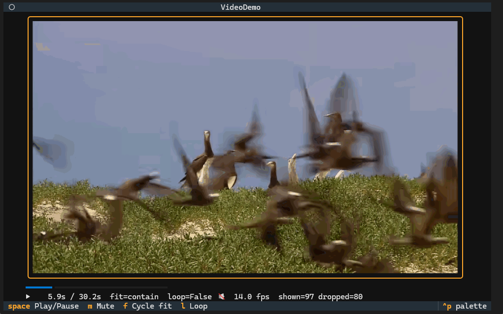

[](https://discord.gg/Enf6Z3qhVr)
[](https://pypi.org/project/textual/)
[](https://badge.fury.io/py/textual)


> [!IMPORTANT]
> ## ✨ What this fork adds to Textual
>
> | | Feature | Example |
> |---|---|---|
> | 🖼️ | **Native `Image` widget**: real images with Sixel, or colored `▀` half blocks on terminals without Sixel | `yield Image("photo.png", fit="cover")` |
> | 🎬 | **`Video` widget with audio**: PyAV + sounddevice, the audio is the master clock, late frames are dropped, ~15 fps for real 720p footage, up to ~30 fps for simpler content in Windows Terminal | `yield Video("movie.mp4", autoplay=True)` |
> | 🌄 | **Background images on any widget** (including `Screen`), showing through transparent widgets | `Screen { background-image: "wallpaper.jpg"; }` |
> | 🎨 | **`background-color`** (alias of `background`), and **`background` accepts an image** | `background: $panel "texture.png" contain;` |
> | ⚡ | **No flicker** when scrolling, resizing, opening menus or typing: text never erases images, images are only re-sent when they change (or just the part that needs it), and everything goes out in a single synchronized frame | — |
> | 🪟 | **First-class Windows Terminal support**: automatic detection of Sixel, cell size and *synchronized output*, which upstream Textual never enabled on Windows | — |
> | 🚀 | **Vectorized Sixel encoder** (NumPy): ~22 ms for an 880×520 px frame | — |
>
> ```bash
> pip install "textual[media] @ git+https://github.com/batatinhafcbatatinha-pixel/textual.git"
> # demos (in a clone of the repository): examples/media/background_demo.py, image_demo.py, video_demo.py
> ```
>
> 📖 Full documentation: [Images, video and backgrounds (Sixel)](#native-images-video-and-backgrounds-sixel--added-by-this-fork)

<table>
<tr>
<td width="33%"></td>
<td width="33%"></td>
<td width="33%"></td>
</tr>
<tr>
<td align="center"><b><code>background-image</code></b><br>on the <code>Screen</code> and on a panel</td>
<td align="center"><b><code>Image</code></b><br><code>fit</code> modes, Sixel vs half blocks</td>
<td align="center"><b><code>Video</code></b><br>with audio, in Windows Terminal</td>
</tr>
</table>

<sub>Screenshots taken in Windows Terminal (Microsoft Store) with the demos in <code>examples/media</code>.</sub>


# Textual


Build cross-platform user interfaces with a simple Python API. Run your apps in the terminal *or* a web browser.

Textual's API combines modern Python with the best of developments from the web world, for a lean app development experience.
De-coupled components and an advanced [testing](https://textual.textualize.io/guide/testing/) framework ensure you can maintain your app for the long-term.

Want some more examples? See the [examples](https://github.com/Textualize/textual/tree/main/examples) directory.

```python
"""
An App to show the current time.
"""

from datetime import datetime

from textual.app import App, ComposeResult
from textual.widgets import Digits


class ClockApp(App):
    CSS = """
    Screen { align: center middle; }
    Digits { width: auto; }
    """

    def compose(self) -> ComposeResult:
        yield Digits("")

    def on_ready(self) -> None:
        self.update_clock()
        self.set_interval(1, self.update_clock)

    def update_clock(self) -> None:
        clock = datetime.now().time()
        self.query_one(Digits).update(f"{clock:%T}")


if __name__ == "__main__":
    app = ClockApp()
    app.run()
```

> [!TIP]
> Textual is an asynchronous framework under the hood. Which means you can integrate your apps with async libraries &mdash; if you want to.
> If you don't want or need to use async, Textual won't force it on you. 


## Widgets

Textual's library of [widgets](https://textual.textualize.io/widget_gallery/) covers everything from buttons, tree controls, data tables, inputs, text areas, and more…
Combined with a flexible [layout](https://textual.textualize.io/how-to/design-a-layout/) system, you can realize any User Interface you need.

Predefined themes ensure your apps will look good out of the box. 


<table>

<tr>

  <td>
    
  
    
  </td>

  <td>
    

    
  </td>
  
</tr>


<tr>

  <td>
    
  
    
  </td>

  <td>
    

    
  </td>
  
</tr>
<tr>

<td>


</td>

<td>


  
</td>

  
</tr>

</table>


## Native images, video and backgrounds (Sixel) — added by this fork

> This fork adds two widgets which don't exist in upstream Textual, **`Image`** and **`Video`**,
> plus a **`background-image`** style for any widget. They draw real pixels with **Sixel** when the
> terminal supports it (for example Windows Terminal from the Microsoft Store), and colored `▀`
> half blocks in any other terminal. The focus is on **no flicker** when scrolling, resizing the
> terminal, or updating other widgets.

### Installing

```bash
pip install "textual[media] @ git+https://github.com/batatinhafcbatatinha-pixel/textual.git"
```

The `media` extra installs the optional dependencies:

| Package | Used by | For |
|---|---|---|
| `pillow` | `Image`, `Video`, backgrounds | loading and scaling images |
| `numpy` | `Image`, `Video`, backgrounds | fast Sixel encoder and half-block fallback |
| `av` (PyAV) | `Video` | decoding video and audio (FFmpeg) |
| `sounddevice` | `Video` | playing audio (optional: without it, video plays muted) |

If a dependency is missing, the widget shows a message explaining what to install instead of crashing the app.

### `Image`


```python
from textual.app import App, ComposeResult
from textual.widgets import Image


class ImageApp(App):
    CSS = "Image { width: 60; }"

    def compose(self) -> ComposeResult:
        yield Image("photo.png")                     # path
        yield Image(open("logo.png", "rb").read())   # bytes
        yield Image(pil_image, fit="cover")          # PIL.Image


ImageApp().run()
```

| Parameter | Default | Description |
|---|---|---|
| `image` | `None` | path, `bytes`, `PIL.Image`, or `None` |
| `fit` | `"contain"` | `contain` keeps the aspect ratio and fills the rest with the background color; `cover` keeps the aspect ratio and crops; `fill` stretches |
| `render_mode` | `"auto"` | `auto` (Sixel if the terminal supports it), `sixel`, or `halfblock` |
| `colors` | `256` | maximum number of colors in the Sixel palette (2–256) |

- **Size:** use regular CSS (`width`, `height`). With `auto` (the default), the widget takes the natural size of the image, limited to the width of its container and keeping the aspect ratio.
- **Changing the image:** just assign it, e.g. `widget.image = "other.png"`. `fit` and `render_mode` can also be changed at runtime.
- **Orientation:** EXIF rotation is applied automatically, and transparent PNGs are blended onto the widget's background color.

### `Video`


```python
from textual.widgets import Video

yield Video("movie.mp4", autoplay=True, loop=False, audio=True)
```

| Parameter | Default | Description |
|---|---|---|
| `source` | — | path (or any URL FFmpeg accepts) |
| `autoplay` | `False` | start playing when mounted |
| `loop` | `False` | restart at the end |
| `audio` | `True` | play the audio track |
| `max_fps` | `None` | limit the frames per second displayed |
| `fit` / `render_mode` | `"contain"` / `"auto"` | same as `Image` |
| `colors` | `128` | colors per frame (fewer colors = faster) |

| API | Description |
|---|---|
| `play()`, `pause()`, `toggle()`, `stop()` | playback control |
| `seek(seconds)` | jump to a position |
| `position`, `duration`, `playing`, `muted` | state (reactive) |
| `frames_shown`, `frames_dropped` | performance statistics |
| `Video.Started`, `Video.Paused`, `Video.Finished` | messages |

**Keys** (when the video has focus): `space` play/pause · `←`/`→` back/forward 5 s · `m` mute.

**Sync:** the audio is the master clock. Decoding, scaling (swscale) and Sixel encoding run in a separate thread, and the UI never waits for them. If the terminal can't keep up, late frames are **dropped**, so the video never falls behind the sound. Without audio, the system clock is used.

### Background images: `background-image`


Any widget, including `Screen`, can have a background image via CSS:

```css
Screen {
    background-image: "wallpaper.jpg";
    background-image-fit: cover;          /* cover (default) | contain | fill */
}

/* Shorthand: color, image and fit together */
#panel { background: $panel "texture.png" contain; }

/* background-color now exists (it's an alias of background) */
Button { background-color: $primary; }
```

Or from Python, at runtime:

```python
self.screen.styles.background_image = "wallpaper.jpg"
self.screen.styles.background_image_fit = "contain"
self.screen.styles.background_image = "none"      # remove it
widget.styles.background_color = "red"            # alias of styles.background
```

| Property | Values | Description |
|---|---|---|
| `background-image` | `"path"` or `none` | image drawn in the area inside the border (padding + content) |
| `background-image-fit` | `cover`, `contain`, `fill` | how the image is scaled (default `cover`) |
| `background` | `<color> ["path"] [fit]` | shorthand: accepts a color, a quoted image and a fit, in any order |
| `background-color` | `<color>` | alias of `background` (color only) |

**Relative paths** are resolved from the current working directory first, then from the folder of the module where your `App` class is defined.

**What shows on top of the background:**

- **Transparent widgets** (no `background`, such as `Label`, `Static` and containers) let the image
  show through their blank cells. Only cells with characters cover the image.
- **Widgets with a background** (`Input`, `Button`, `Select`, or any `background` with alpha > 0)
  cover the image where they are. A terminal can't blend text with Sixel, so
  `background: $panel 60%` is solid over the image.
- When something that covered the image moves away (a menu closes, text gets shorter, a widget
  scrolls or disappears), the compositor re-sends **only that part** of the image, in the same
  synchronized frame, with no flicker.

On terminals without Sixel the background image is drawn with colored `▀` half blocks. In that mode,
transparent child widgets show the regular background color, not the image.

### Demos

```bash
python examples/media/image_demo.py [image ...]            # images in a scroll view + a Select on top
python examples/media/video_demo.py [video] --mute --loop --colors 256  # video with a progress bar and fps
python examples/media/background_demo.py [image]           # background-image on the Screen and on a panel
```

`examples/media/make_sample.py` and `make_sample_video.py` generate the sample files (`sample.png` and `sample.mp4`).

### How the flicker was removed

In Windows Terminal (and most terminals with Sixel), **writing any character over a cell erases the
part of the image in that cell**. Textual redraws the screen by writing text, so the naive approach
(drawing the image after every update) is stuck in an *erase → redraw* loop: that's the flicker.
The fix lives inside the compositor itself:

1. **Graphics cells are never written.** Widgets mark the cells covered by an image with a private-use
   character. When the output is generated, `Strip.render` turns those cells into `CSI n C`, which
   moves the cursor without writing anything, so the image stays intact.
2. **An image is only re-sent when it changes.** On every frame the compositor works out the visible
   area of each graphic (taking scrolling and clipping into account) and compares it with the
   previous frame. A Sixel is only generated when the image is new, moved, is cropped differently,
   changed content (a new video frame), or when the terminal was resized. Typing in an `Input`
   re-sends nothing.
3. **Leftovers are cleaned up and holes are repaired.** The area an image no longer covers (after a
   scroll, or removing the widget) is marked for redrawing, and the text written there erases the old
   image. The compositor also tracks, cell by cell, whether the terminal is showing the image. When a
   cell goes back to being an image cell after text erased it (closed menu, shorter text), only that
   rectangle is re-sent.
4. **Everything in a single frame.** Images are written before the text, in the same *synchronized
   output* block (`CSI ?2026h … l`). The terminal shows the result at once, and overlapping widgets
   (menus, notifications) are written afterwards, so they stay on top of the image.
5. **Automatic detection.** The Windows and Linux drivers query synchronized output support, DA1
   (which reports Sixel), and the cell size in pixels (`CSI 16 t`). Before this fork, the Windows
   driver never enabled synchronized output.

The Sixel encoder (`textual/_sixel.py`) is vectorized with NumPy: about 22 ms for a simple 880×520 px
frame with 128 colors, and about 45 ms for a detailed frame of real footage at 960×560 px. In Windows
Terminal, `Video` reaches about 27–30 fps with simple content and about 15 fps with real 720p footage
at that size (fewer `colors` or a smaller widget are faster; late frames are dropped to stay in sync).

### Environment variables

| Variable | Effect |
|---|---|
| `TEXTUAL_GRAPHICS=sixel` | force Sixel (useful if the terminal doesn't report support) |
| `TEXTUAL_GRAPHICS=halfblock` | force half blocks for all widgets in `auto` mode |

### Known limitations

- Sixel only; the Kitty and iTerm2 protocols aren't implemented yet (`halfblock` is used without Sixel).
- Images aren't shown in *inline* mode (`App.run(inline=True)`), which uses `halfblock`.
- On dimmed screens (behind a `ModalScreen`), images aren't dimmed.
- Video gradients can show banding with 128 colors; use `colors=256` for better quality (at fewer fps).

Design details in [`docs/superpowers/specs/2026-11-09-sixel-image-video-design.md`](docs/superpowers/specs/2026-11-09-sixel-image-video-design.md).


## Installing

Install Textual via pip:

```
pip install textual textual-dev
```

See [getting started](https://textual.textualize.io/getting_started/) for details.


## Demo


Run the following command to see a little of what Textual can do:

```
python -m textual
```

Or try the [textual demo](https://github.com/textualize/textual-demo) *without* installing (requires [uv](https://docs.astral.sh/uv/)):

```bash
uvx --python 3.12 textual-demo
```


## Dev Console


How do you debug an app in the terminal that is also running in the terminal?

The `textual-dev` package supplies a dev console that connects to your application from another terminal.
In addition to system messages and events, your logged messages and print statements will appear in the dev console.

See [the guide](https://textual.textualize.io/guide/devtools/) for other helpful tools provided by the `textual-dev` package.


## Command Palette


Textual apps have a *fuzzy search* command palette.
Hit `ctrl+p` to open the command palette.

It is easy to extend the command palette with [custom commands](https://textual.textualize.io/guide/command_palette/) for your application.


# Textual ❤️ Web


Textual apps are equally at home in the browser as they are the terminal. Any Textual app may be served with `textual serve` &mdash; so you can share your creations on the web.
Here's how to serve the demo app:

```
textual serve "python -m textual"
```

In addition to serving your apps locally, you can serve apps with [Textual Web](https://github.com/Textualize/textual-web).

Textual Web's firewall-busting technology can serve an unlimited number of applications.

Since Textual apps have low system requirements, you can install them anywhere Python also runs. Turning any device into a connected device.
No desktop required!


## Join us on Discord

Join the Textual developers and community on our [Discord Server](https://discord.gg/Enf6Z3qhVr).
